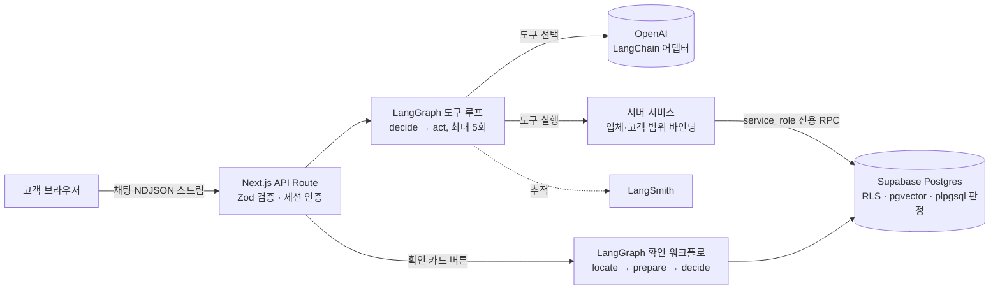

# ShopOps AI

의류몰 Style Shop의 고객 상담을 맡는 AI CS 에이전트입니다. 고객은 채팅으로 정책 문의, 상품 추천, 장바구니·주문, 배송 조회, 반품·교환·취소·배송지 변경까지 처리합니다. 모든 데이터는 합성 데이터이며 결제·택배는 모의 구현입니다.

> **한 줄 설계 원칙:** 고객이 무엇을 원하는지는 모델이 판단하고, 그 일을 해도 되는지와 실제 실행은 서버와 DB가 결정한다. 돈이나 주문 상태가 바뀌는 일은 고객이 확인 버튼을 눌러야만 실행된다.


실제 모델(OpenAI)과 로컬 Supabase로 녹화했습니다(1.6배속). 원본 영상: [demo/shopops-agent-demo.mp4](demo/shopops-agent-demo.mp4)

## 무엇을 보여주는가

| 고객이 하는 말 | 에이전트가 하는 일 |
| --- | --- |
| "반품 기간이 어떻게 돼요?" | 업체 정책을 pgvector로 검색해 출처와 함께 답한다. 근거가 없으면 답을 보류한다. |
| "블랙 재킷 M 담아줘" → "주문할게요" | 재고 안에서 장바구니에 담고, 주문 확인 카드를 띄운다. 고객이 누르면 모의 결제·주문이 생성된다. |
| "내 재킷 어디쯤 왔어?" | 로그인한 고객의 주문만 조회해 마지막 택배 스캔을 보여준다. |
| "아이보리 셔츠 교환하고 싶어요" | 현재 주문 사이즈와 교환 가능한 재고 사이즈를 안내하고, 상품 상태 확인 체크가 있어야 신청 버튼이 켜진다. |
| "머플러 주문 배송지 바꿔줘" | DB가 출고 전·결제 후 30분 이내인지 먼저 판정하고, 통과하면 저장된 배송지 버튼을 보여준다. |

## 아키텍처



- **모델이 하는 일:** 고객 의도 파악, 다음에 호출할 도구와 인자 선택, 최종 문장 작성.
- **서버가 하는 일:** 업체·고객 ID를 인증 세션에서만 바인딩(모델·사용자 입력의 tenantId는 신뢰하지 않음), 모델이 넘긴 주문번호·배송지 ID가 이번 대화에서 실제로 조회된 것인지 확인.
- **DB가 하는 일:** 반품·교환·취소·배송지 변경 가능 여부를 plpgsql 함수 하나에서 판정하고, 확인 카드 생성 때와 버튼을 누를 때 **두 번** 검사한다. 고객 역할은 이 함수를 직접 실행할 수 없다.

LangGraph 구조는 코드에서 생성한 그림으로 [docs/AGENT_GRAPHS.md](docs/AGENT_GRAPHS.md)에 있습니다.

## 핵심 설계 결정

1. **실행 권한을 모델에서 분리.** 모델은 `prepare_*` 도구로 "초안"만 만들 수 있다. 실제 쓰기(`confirm_order_change`, 주문 생성, 반품 접수)는 고객이 확인 카드에서 누른 요청으로만 들어오고, 이때 요청 본문은 서버 고정 문구로 저장한다. 장바구니 담기만 예외로, 본인 장바구니·수량 1~10·재고 이내·되돌릴 수 있는 변경으로 제한했다.
2. **확정 시점 재검증과 멱등성.** 카드를 띄운 뒤 재고가 사라지거나 장바구니가 바뀌면 확정을 거부한다(`out_of_stock`, `cart_changed`). 같은 승인 요청을 다시 보내면 새로 실행하지 않고 처음 접수번호를 돌려준다. 세션당 대기 중 승인은 하나뿐이다.
3. **멀티테넌트 격리를 DB에서 강제.** 모든 업체 소유 행에 `tenant_id` FK와 RLS를 걸고, 검색 RPC는 고객이 직접 실행할 수 없다. 테스트가 다른 업체의 청크·주문·채팅에 접근하지 못하는지 검사한다.
4. **환각 방어.** 모델이 반환한 출처 ID는 실제 검색 결과에 있는 것만 통과시키고, 근거가 없으면 보류한다. 질문에 상품명이 있으면 모델이 이전 턴의 다른 주문번호를 넣어도 상품명이 맞는 주문만 쓴다.
5. **결과 목록은 한 곳에서.** "반품 가능한 주문 N건"의 숫자와 카드는 같은 서버 결과에서 만든다. 개별 주문이 빠진 이유는 별도 판정 도구로 조회한다.

## 검증

| 항목 | 결과 |
| --- | --- |
| DB 테스트 (pgTAP) | 100개 — 권한, 타 고객·타 업체 차단, 재고 복구 1회, 재시도 시 같은 접수번호, 기한·상태별 판정 |
| 단위 테스트 (Vitest) | 48개 — 키 없이 fake 모델·RPC로 실행. 도구 인자 신뢰 범위, 멀티턴 문맥, 가짜 출처 차단 |
| E2E (Playwright) | 키 없는 화면 데모 8개, 로컬 Supabase 흐름(반품 승인·새로고침·재시도, 세션 격리) |
| 상담 시나리오 | 61개 멀티턴 시나리오를 실제 모델로 실행해 실패 유형별로 수정·재확인 (`scripts/cs-scenarios.mjs`) |
| RAG 평가 | 정책 40개·질문 48개: Recall@5 22/24, 근거 없는 질문 보류 12/12, 타 쇼핑몰 요청 보류 12/12, 타 테넌트 누출 0/48 ([보고서](tests/evals/README.md)) |

```sh
npm run lint && npm run typecheck && npm run test && npm run build
npm run test:e2e          # 키 없는 화면 데모
supabase test db          # pgTAP
```

## 기술 스택

Next.js 16 (App Router) · TypeScript strict · Supabase (Auth, Postgres 17, RLS, pgvector) · LangChain.js · LangGraph · OpenAI · LangSmith · Zod · Vitest · Playwright · pgTAP

## 실행

**키 없는 화면 데모** — 규칙 기반 검색과 서버 메모리의 합성 데이터로 동작합니다.

```sh
npm ci
npm run dev   # http://localhost:3000
```

**실제 모델 + 로컬 Supabase** — Docker, Supabase CLI, `.env.local`의 `OPENAI_API_KEY`가 필요하며 OpenAI 사용량이 청구됩니다. 시드와 실행 순서는 [시연 가이드](demo/README.md)와 [인수인계 문서](docs/HANDOFF.md)에 있습니다. 채팅 상단의 **[비로그인] [고객 A] [고객 B]** 버튼으로 합성 고객을 바로 전환합니다.

## 로드맵

- **운영 지표:** 답변 피드백(도움 됨/안 됨)과 업체별 토큰·추정 비용 대시보드 (테이블 설계 완료)
- **공개 데모 배포:** 일일 비용 한도, IP별 요청 제한, 데모 데이터 정기 초기화
- **Phase 3:** 송장 OCR·상품 파손 사진 Vision, 문서 처리 Worker와 큐, 모니터링
- **검색 고도화:** Hybrid Search·Rerank를 독립 평가셋으로 비교

결제·택배·환불은 모의 구현이며 모든 데이터는 합성 데이터입니다.

## 문서

[PRD](docs/PRD.md) · [아키텍처](docs/ARCHITECTURE.md) · [DB](docs/DATABASE.md) · [AI 설계](docs/AI_DESIGN.md) · [구현 계획](docs/IMPLEMENTATION_PLAN.md) · [인수인계](docs/HANDOFF.md)
