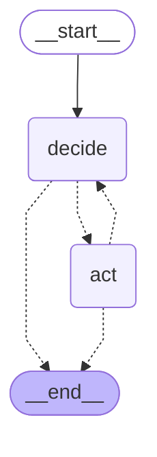
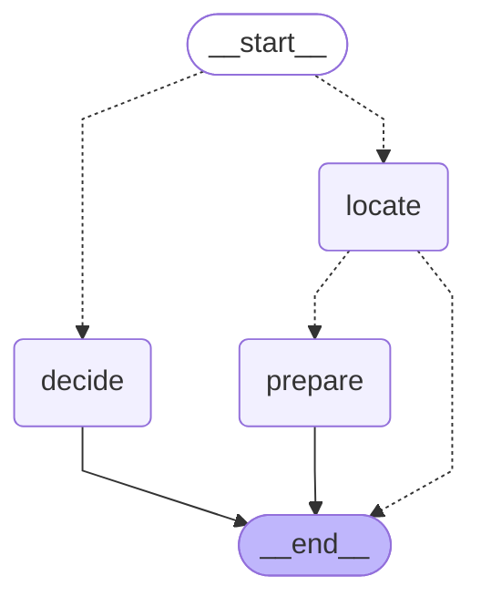

# 에이전트 LangGraph 구조

코드에서 생성한 그림이다. 다시 만들기: `PRINT_GRAPHS=1 npx vitest run tests/unit/agent-graphs.test.ts`

## 한 턴의 도구 루프 (`src/server/agent-loop.ts`)

decide: 모델이 다음 도구를 고른다. act: 서버가 도구를 실행한다. 한 턴 최대 5결정.

## 접수·주문 확인 워크플로 (`src/server/agent-workflow.ts`)

locate: 주문 찾기. prepare: 확인 카드 초안. decide: 고객이 누른 버튼을 DB에서 처리.

