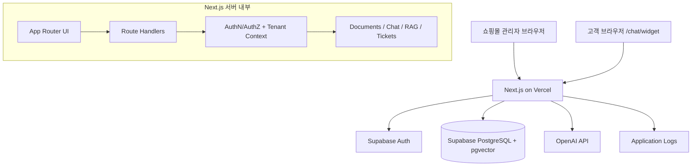
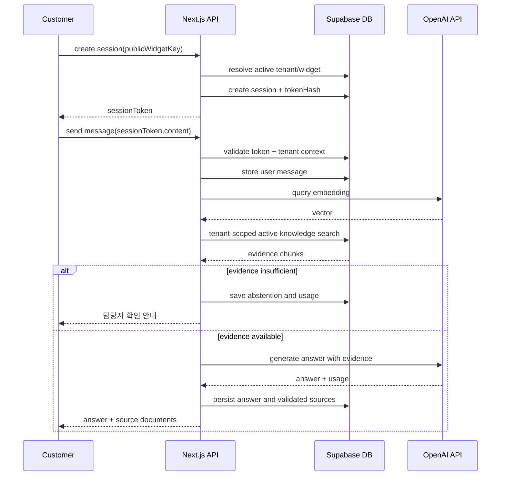

# ARCHITECTURE — 시스템 구성 및 API 계약

> 버전: 1.0 · Phase 1 구현 기준 · 전제는 [PRD](./PRD.md) 참고

## 1. 아키텍처 의사결정(ADR 요약)

| 결정 | 채택 이유 | 트레이드오프 |
|---|---|---|
| Next.js App Router + Route Handlers | React와 API를 동일 프로젝트에서 빠르게 구현 | 배치/긴 작업에 부적합 |
| Vercel | Next.js 배포와 Preview/CI 간편 | 실행시간·서버리스 제약 |
| Supabase Auth + PostgreSQL | Auth, RLS, 트랜잭션, 데이터 계층 통합 | DB 보안 정책 설계 필요 |
| pgvector | 업무 DB와 벡터 검색을 같은 DB에서 수행 | 대규모 벡터 검색 시 튜닝 필요 |
| LangChain.js | 문서 로딩·청킹·Embeddings/RAG 조립 | 버전별 API 차이 → 어댑터에 격리 |
| OpenAI API | 임베딩과 생성 모델의 서버 호출 | 사용량 비용, 모델 변동, 외부 의존 |
| Phase 1 단일 서비스 | 최소 복잡도로 완주 | Phase 3 큐/Worker 추출 필요 |
| 런타임 권한: 브라우저는 user-scoped, 공개 API는 server-only | 공개 세션 접근과 RLS를 구분 | 서버 측 tenant 검증이 특히 중요 |

**금지:** Phase 1에 NestJS·Redis·Kubernetes·LangGraph·별도 Vector DB를 무근거로 추가하지 않는다.

## 2. 시스템 컨텍스트



브라우저는 `OPENAI_API_KEY`와 Supabase secret key에 접근할 수 없다. 관리자 요청은 쿠키 세션을 통해 인증하고 서버에서 `auth.getUser()` 등 검증된 사용자 ID로 멤버십을 확인한다. 공개 고객은 플랫폼 내부에서 발급한 별도 상담 세션 토큰으로 인증한다.

### 요청 경계
1. **관리자:** `user JWT` → 서버 AuthN → `(tenant_id, user_id, role)` 멤버십 확인 → 업무 로직. Supabase user-scoped client를 통해 RLS 보호. 필요 시 server-only secret client가 쓰이는 코드에도 선행 인가 필수.
2. **고객:** `publicWidgetKey` → 활성 위젯/업체 조회 → 단기 고엔트로피 `sessionToken` 발급 → 후속 API에서 해시 대조. 고객은 관리자 JWT나 DB 직접 조회 권한 없음.
3. **RAG:** 서버가 검증한 `tenantId`를 검색 함수에 전달. 사용자나 LLM이 만든 `tenantId`는 절대 신뢰하지 않음.
4. **인덱싱:** 서버가 문서 소유권을 확인하고, 짧은 작업 한정으로 호출. 최대 문서·청크·토큰 수 제한. 장시간 작업은 Phase 3.

## 3. 서비스 모듈 및 디렉터리

```text
shop-ai-agent/
├── AGENTS.md
├── docs/{PRD,ARCHITECTURE,DATABASE,AI_DESIGN,IMPLEMENTATION_PLAN}.md
├── src/
│   ├── app/
│   │   ├── (auth)/login/page.tsx
│   │   ├── (auth)/signup/page.tsx
│   │   ├── dashboard/[tenantSlug]/knowledge/
│   │   ├── dashboard/[tenantSlug]/conversations/
│   │   ├── chat/[publicWidgetKey]/page.tsx
│   │   └── api/
│   │       ├── tenants/
│   │       ├── public/sessions/
│   │       └── public/messages/
│   ├── components/{ui,chat,knowledge}/
│   ├── features/{auth,tenants,knowledge,chat,tickets}/
│   ├── server/
│   │   ├── auth/require-tenant-role.ts
│   │   ├── db/{user-client,admin-client}.ts
│   │   ├── repositories/
│   │   ├── services/{document-service,chat-service,ticket-service}.ts
│   │   ├── rag/{chunk,embed,retrieve,answer}.ts
│   │   ├── security/{public-session,rate-limit}.ts
│   │   └── observability/{logger,usage}.ts
│   ├── lib/{env,errors,validators}.ts
│   └── types/
├── supabase/migrations/
├── supabase/seed.sql
├── tests/{unit,integration,e2e,evals}/
├── .env.example
└── package.json
```

경로는 구현 시작점. Next.js의 실제 라우트 파일, TypeScript 패키지 구성, Supabase SSR용 클라이언트 코드는 설치된 안정 버전 문서를 확인해 조정하되 **보안·도메인 계약은 변경하지 않는다**.

### 핵심 인터페이스 (권장)

```ts
export type TenantContext = {
  tenantId: string;
  actor: { kind: 'admin'; userId: string; role: 'owner' | 'staff' }
       | { kind: 'customer'; sessionId: string };
};

export interface Retriever {
  retrieve(input: {
    tenantId: string;
    query: string;
    topK?: number;
  }): Promise<Array<{
    chunkId: string; documentId: string; version: number;
    content: string; distance: number;
  }>>;
}

export interface ChatModelGateway {
  answer(input: { question: string; evidence: string; history: string[] }):
    Promise<{ text: string; usage?: { inputTokens: number; outputTokens: number } }>;
}
```

사용 중인 라이브러리 타입을 domain 전역으로 퍼뜨리지 않는다. LangChain·OpenAI 타입은 `server/rag` 내 어댑터에 가둔다.

## 4. API 설계 (Phase 1)

공통 사항:
- JSON 요청/응답; HTTP status 사용; 공통 에러 `{ "error": { "code": "...", "message": "...", "requestId": "..." } }`.
- 모든 path param은 UUID/slug Zod 검증; body schema 제한; 최대 입력 길이(문서 10k자, 질문 2k자 등) 적용.
- 인증 불명확 401, 권한 불충분 403, 다른 업체 ID를 통한 열거 방지를 위해 리소스 조회는 404 사용 가능.
- 쓰기 API는 멱등성 또는 충돌 처리를 정의; 사용자에게 내부 오류 stack/DB 상세를 반환하지 않음.

### 인증 관리자 API

| Method / Path | 입력(핵심) | 출력 / 조건 |
|---|---|---|
| `POST /api/tenants` | `{name,slug}` | 201 `{id,name,slug,publicWidgetKey}`; 로그인 필요; owner membership 원자 생성, Next.js에서 검증한 사용자 ID를 서버 전용 RPC에 전달 |
| `GET /api/tenants` | 없음 | 소속 업체만 반환 |
| `GET /api/tenants/:tenantId/documents` | `page`, `status` | 자기 업체 자료 + 상태, pagination |
| `POST /api/tenants/:tenantId/documents` | `{title, kind: 'faq'\|'markdown', content}` | 201 `{id,indexStatus:'pending'}`; owner/staff |
| `GET /api/tenants/:tenantId/documents/:id` | 없음 | 단건 조회 |
| `PATCH /api/tenants/:tenantId/documents/:id` | `{expectedVersion,title?,content?,kind?}` | 버전 증가, 검색 노출 제어, `pending` |
| `DELETE /api/tenants/:tenantId/documents/:id` | `{expectedVersion}` | soft delete, 즉시 검색 제외 |
| `POST /api/tenants/:tenantId/documents/:id/index` | `{expectedVersion}` | 동기 소규모 인덱싱. `{status:'ready'\|'failed'}`; 중복 호출 안전 |
| `GET /api/tenants/:tenantId/conversations` | cursor | 자기 업체 상담 이력. 개인정보 노출 범위 최소화 |
| `GET /api/tenants/:tenantId/conversations/:sessionId` | 없음 | 해당 업체 세션인지 확인 후 메시지 반환 |

### 공개 고객 API

| Method / Path | 입력(핵심) | 출력 / 조건 |
|---|---|---|
| `POST /api/public/sessions` | `{publicWidgetKey}` | 201 `{sessionId,sessionToken,expiresAt}`; 토큰은 메모리에만 보관 |
| `POST /api/public/messages` | 헤더 `Authorization: Bearer <sessionToken>` + `{sessionId,clientRequestId,content}` | `{messageId,answer,sources:[{documentId,title}],abstained,requestId}` |
| `GET /api/public/sessions/:sessionId/messages` | sessionToken | 동일 세션 소유자만 목록 반환 |
| P1 `POST /api/public/tickets` | sessionToken + `{sessionId,reason,contact?}` | 201 `{ticketId,status}` |
| P1 `POST /api/public/feedback` | sessionToken + `{messageId,rating}` | 204 |

Style Shop 상품 추천 시연(P2-08)은 같은 메시지 API에서 `catalog.products`를 추가로 반환한다. 상품과 가격·사이즈별 재고는 읽기 전용 서버 카탈로그에서 가져오며, 후속 조건은 인증된 상담 세션의 마지막 상품 응답에 저장한다. 정책 질문은 기존 정책 검색과 출처 검증 흐름을 사용한다.

Style Shop의 실제 모델 시연에서는 모델이 도구를 선택하고 서버가 입력을 검증해 실행한 결과를 다시 받는다. 한 턴에 최대 네 번 결정한다. 주문 조회는 검증된 고객과 업체에 한정되며, 모델의 문맥에는 주문번호·상품·배송 상태 등 필요한 업무 데이터를 포함한다. 고객 인증 쿠키나 내부 DB 식별자는 서버에서 관리하고, 로그인 고객의 세션은 요청마다 같은 고객인지 재검증한다. 고객의 접수 결정은 같은 메시지 API의 `action` 요청으로 받고, 서버와 DB가 직접 실행한다.

채팅 클라이언트가 `Accept: application/x-ndjson`을 보내면 같은 메시지 API에서 실제 작업 단계와 최종 응답을 줄 단위로 전달한다. 이벤트는 도구 선택, 결과 확인, 정책·상품·주문 조회 단계로 구성한다. 택배 추적은 마지막 스캔과 이동 기록을, 주문 내역은 고객이 소유한 최근 주문 최대 20건을 반환한다.

**세션 토큰 설계** 불투명 bearer token을 발행하고 DB에는 SHA-256 해시를 저장한다. 서버는 세션 ID, 토큰 해시, 만료와 폐기를 검증한다. Supabase 채팅 세션의 유효 기간은 30분이다. 기본 프론트엔드는 토큰을 메모리에 두며, Style Shop 공개 채팅에서는 같은 탭에서 재개할 수 있도록 `sessionStorage`에도 저장한다. 새 대화와 고객 로그인·로그아웃 시 탭에 저장된 토큰을 지운다.

**위젯 키 주의:** `publicWidgetKey`는 공개 식별자이고 인증 수단이 아니다. Origin/CORS만으로 남용을 막을 수 없다. IP + 세션 rate limit, 요청 길이·토큰 예산, 서비스 비활성화 스위치, 필요 시 CAPTCHA를 추가한다. 쇼핑몰 도메인 내 임베딩 위젯은 Phase 2 이후.

### 에러 코드
- `UNAUTHENTICATED`, `FORBIDDEN`, `NOT_FOUND`, `VALIDATION_ERROR`
- `RATE_LIMITED`, `SESSION_EXPIRED`, `DOCUMENT_VERSION_CONFLICT`
- `INDEXING_FAILED`, `MODEL_UNAVAILABLE`, `COST_BUDGET_EXCEEDED`

## 5. 핵심 시퀀스

### A. 문서 등록·수정·인덱싱

```mermaid
sequenceDiagram
  participant U as Tenant Admin
  participant A as Next.js API
  participant DB as Supabase DB
  participant O as OpenAI Embeddings
  U->>A: POST /documents
  A->>A: Auth + tenant membership + Zod
  A->>DB: insert documents(status=pending)
  DB-->>A: document id + version
  A-->>U: 201 id
  U->>A: POST /documents/{id}/index
  A->>DB: claim index version / set indexing
  A->>A: normalize + chunk
  A->>O: embeddings(batch)
  O-->>A: vectors
  A->>DB: transaction: upsert chunks for current version; set active_version/status=ready
  A-->>U: result
```

**원자성/재시도 규칙:** 원문 변경은 version 증가. 임베딩 작업의 결과를 반영할 때 `documents.version == expectedVersion` 검증하고 청크 교체·상태 변경은 DB 트랜잭션으로 묶는다(RPC/DB function 또는 서버 DB 트랜잭션). 중간 실패 시 기존 활성 버전 정책은 PRD의 기본값(검색 제외). `ready`가 아닌 문서는 검색 대상이 아니다. 중복 인덱싱 호출은 동일 문서/버전 1개만 실행하게 충돌/락 처리. 외부 임베딩 호출을 DB 트랜잭션 중 열린 상태로 기다리지 않는다.

### B. 고객 채팅



검색 결과의 `documentId`가 같은 tenant에 속하는지 서버 재확인. LLM이 반환한 출처 ID를 그대로 신뢰하지 않고 서버가 검색했던 source set 안에서만 반환한다.

## 6. 배포·환경 변수

| 변수 | 위치 | 비고 |
|---|---|---|
| `NEXT_PUBLIC_SUPABASE_URL` | browser/server | 공개 가능 |
| `NEXT_PUBLIC_SUPABASE_PUBLISHABLE_KEY` | browser/server | 공개용 키 |
| `SUPABASE_SECRET_KEY` | **server only** | bypass RLS, 최소 사용; legacy service_role 대체 가능 |
| `OPENAI_API_KEY` | **server only** | 호출·운영비 과금 키 |
| `OPENAI_CHAT_MODEL` | server | 현재 지원되는 모델명을 구성 값으로 설정 |
| `OPENAI_EMBEDDING_MODEL` | server | `text-embedding-3-small` |
| `PUBLIC_CHAT_RATE_LIMIT_*` | server | 제한 정책; 저장소 연동 시 인증정보 별도 |
| `APP_BASE_URL` | server | 절대 URL/redirect 검증용 |

`.env.local`을 커밋하지 않는다. Vercel Preview/Production과 Supabase 개발/운영 DB 환경을 분리하고, 프로덕션 migration을 적용하기 전 백업/다운타임 계획을 점검한다.

### CI 게이트
`npm ci` → lint → typecheck → unit/integration (로컬 테스트 DB 필요) → `npm run build` → Preview smoke → production deploy. DB 마이그레이션과 제품 배포 순서를 고려한다. DB 시크릿이 필요한 E2E는 격리된 테스트 프로젝트에서 수행.

## 7. 운영 한계 및 확장 계획

- **Phase 1:** 소량 FAQ 임베딩만 동기 인덱싱. 함수 실행 시간과 비용 상한 초과 시 명확히 실패/재시도.
- **Phase 2:** `OrderProvider` adapter + mock-commerce API + LangGraph; Tool Calling은 읽기/쓰기 권한 분리.
- **Phase 3:** VPS Worker, idempotent queue, PDF/OCR/Vision, 관측·재시도·DLQ, 필요 시 독립 NestJS/Railway API.
- DB pool 및 네트워크 문제, external API rate limit, cold start를 모니터링해야 한다. 초기 성능값을 보장하지 않는다.

## 8. 참고 문서
- [Supabase RLS](https://supabase.com/docs/guides/database/postgres/row-level-security)
- [Supabase pgvector](https://supabase.com/docs/guides/database/extensions/pgvector)
- [Next.js + vector search](https://supabase.com/docs/guides/ai/examples/nextjs-vector-search)
- [Next.js Route Handlers](https://nextjs.org/docs/app/building-your-application/routing/route-handlers)
