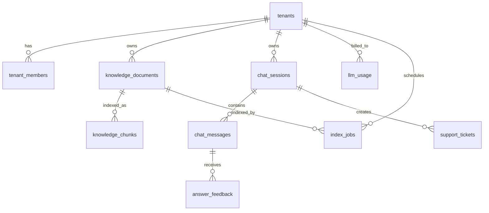

# DATABASE — PostgreSQL 스키마·마이그레이션·RLS

> 버전: 1.0 · Phase 1 DB 계약. **Supabase 프로젝트 전용 테스트 DB에서 검증 후 적용**할 것.  
> 엔티티와 API 범위는 [PRD](./PRD.md), [ARCHITECTURE](./ARCHITECTURE.md)를 기준으로 한다.

## 1. 설계 원칙

1. 모든 쇼핑몰 소유 데이터는 `tenant_id uuid not null` 보유. 문서·청크·상담·티켓·사용량에 걸친 일관성 확보.
2. 사용자 ID는 Supabase `auth.users.id` 사용. Role은 `tenant_members` DB에 보관하고 클라이언트 입력이나 user metadata로 신뢰하지 않는다.
3. RLS를 **모든 공개 스키마 테이블에 활성화**, 기본 거부. `anon`에게 tenant 데이터를 직접 조회시키지 않음.
4. 관리자 읽기는 Supabase 사용자 JWT + RLS. 쓰기는 Next.js API가 인증·역할 검사 후 서버 전용 DB 클라이언트로 실행. 서버 전용 secret key는 **RLS 우회**하므로 검증 누락은 심각한 취약점.
5. 고객 공개 채팅은 별도 `chat_sessions.token_hash` 인증으로 Next.js API를 통해서만 데이터 접근.
6. 문서 재인덱싱은 버전 단위; `ready` 문서의 `active_version`에 해당하는 청크만 검색.
7. PostgreSQL 마이그레이션은 `supabase/migrations/*.sql`에서 관리. 아래 DDL은 설계 기준이며 실제 파일로 분리해 적용한다.

## 2. ERD



## 3. 필수 테이블 SQL (Phase 1)

> 주의: Supabase에서 vector 확장 설치 스키마를 확인하고, 아래 예시는 `extensions.vector` 사용. 표준 UUID와 시각은 Postgres 타입 사용.

```sql
create schema if not exists extensions;
create extension if not exists vector with schema extensions;
create schema if not exists private;

create table public.tenants (
  id uuid primary key default gen_random_uuid(),
  name text not null check (char_length(name) between 2 and 120),
  slug text not null unique check (slug ~ '^[a-z0-9][a-z0-9-]{2,49}$'),
  public_widget_key text not null unique default replace(gen_random_uuid()::text, '-', ''),
  is_active boolean not null default true,
  created_at timestamptz not null default now()
);

create table public.tenant_members (
  tenant_id uuid not null references public.tenants(id) on delete cascade,
  user_id uuid not null references auth.users(id) on delete cascade,
  role text not null check (role in ('owner', 'staff')),
  created_at timestamptz not null default now(),
  primary key (tenant_id, user_id)
);
create index tenant_members_user_idx on public.tenant_members(user_id, tenant_id);

create table public.knowledge_documents (
  id uuid primary key default gen_random_uuid(),
  tenant_id uuid not null references public.tenants(id) on delete cascade,
  kind text not null check (kind in ('faq', 'markdown')),
  title text not null check (char_length(title) between 1 and 200),
  content text not null check (char_length(content) between 1 and 10000),
  version integer not null default 1 check (version >= 1),
  active_version integer,
  index_status text not null default 'pending'
     check (index_status in ('pending','indexing','ready','failed')),
  error_code text,
  deleted_at timestamptz,
  indexed_at timestamptz,
  created_at timestamptz not null default now(),
  updated_at timestamptz not null default now(),
  unique (tenant_id, id),
  check (active_version is null or active_version <= version)
);
create index knowledge_documents_tenant_status_idx
  on public.knowledge_documents(tenant_id, index_status) where deleted_at is null;

create table public.knowledge_chunks (
  id uuid primary key default gen_random_uuid(),
  tenant_id uuid not null,
  document_id uuid not null,
  document_version integer not null check (document_version >= 1),
  chunk_index integer not null check (chunk_index >= 0),
  content text not null,
  embedding extensions.vector(1536) not null,
  embedding_model text not null,
  created_at timestamptz not null default now(),
  foreign key (tenant_id, document_id)
    references public.knowledge_documents(tenant_id, id) on delete cascade,
  unique (tenant_id, document_id, document_version, chunk_index)
);
create index knowledge_chunks_tenant_doc_idx
  on public.knowledge_chunks(tenant_id, document_id, document_version);
-- MVP는 tenant-scoped exact scan으로 시작한다. 실제 데이터/EXPLAIN을 확인한 뒤 HNSW 검토.
-- create index knowledge_chunks_hnsw_idx on public.knowledge_chunks
--   using hnsw (embedding extensions.vector_cosine_ops);

create table public.chat_sessions (
  id uuid primary key default gen_random_uuid(),
  tenant_id uuid not null references public.tenants(id) on delete cascade,
  token_hash text not null unique,
  expires_at timestamptz not null,
  revoked_at timestamptz,
  created_at timestamptz not null default now(),
  unique (tenant_id, id)
);
create index chat_sessions_tenant_created_idx
  on public.chat_sessions(tenant_id, created_at desc);

create table public.chat_messages (
  id uuid primary key default gen_random_uuid(),
  tenant_id uuid not null,
  session_id uuid not null,
  role text not null check (role in ('user','assistant')),
  content text not null check (char_length(content) between 1 and 20000),
  source_refs jsonb not null default '[]'::jsonb,
  abstained boolean not null default false,
  client_request_id uuid,
  created_at timestamptz not null default now(),
  foreign key (tenant_id, session_id)
    references public.chat_sessions(tenant_id, id) on delete cascade,
  check (jsonb_typeof(source_refs) = 'array')
);
create index chat_messages_session_idx
  on public.chat_messages(tenant_id, session_id, created_at);
create unique index chat_messages_request_dedupe_idx
  on public.chat_messages(tenant_id, session_id, client_request_id)
  where client_request_id is not null and role = 'user';

create table public.support_tickets (
  id uuid primary key default gen_random_uuid(),
  tenant_id uuid not null,
  session_id uuid not null,
  title text not null,
  description text not null,
  status text not null default 'open'
    check (status in ('open','in_progress','resolved')),
  contact_info jsonb not null default '{}'::jsonb,
  created_at timestamptz not null default now(),
  updated_at timestamptz not null default now(),
  foreign key (tenant_id, session_id)
    references public.chat_sessions(tenant_id, id) on delete cascade
);
create index support_tickets_tenant_status_idx
  on public.support_tickets(tenant_id, status, created_at desc);

create table public.answer_feedback (
  id uuid primary key default gen_random_uuid(),
  tenant_id uuid not null,
  message_id uuid not null references public.chat_messages(id) on delete cascade,
  rating text not null check (rating in ('helpful','unhelpful')),
  created_at timestamptz not null default now(),
  unique (message_id)
);
-- answer_feedback.tenant_id의 메시지 일치는 서버에서 검증해야 하며,
-- 실제 구현에서는 아래 복합 FK를 추가해 DB에서도 강제한다.
create unique index chat_messages_tenant_id_id_uq
  on public.chat_messages(tenant_id, id);
alter table public.answer_feedback
  add constraint feedback_same_tenant_fk
  foreign key (tenant_id, message_id)
  references public.chat_messages(tenant_id, id) on delete cascade;

create table public.llm_usage (
  id uuid primary key default gen_random_uuid(),
  tenant_id uuid not null references public.tenants(id) on delete cascade,
  session_id uuid,
  request_id uuid not null,
  provider text not null default 'openai',
  model text not null,
  operation text not null check (operation in ('embedding','generation','vision')),
  input_tokens integer not null default 0 check (input_tokens >= 0),
  output_tokens integer not null default 0 check (output_tokens >= 0),
  estimated_cost_usd numeric(16,8),
  duration_ms integer,
  status text not null check (status in ('success','failed')),
  created_at timestamptz not null default now(),
  unique (request_id, operation),
  foreign key (tenant_id, session_id)
    references public.chat_sessions(tenant_id, id) on delete set null (session_id)
);
create index llm_usage_tenant_date_idx
  on public.llm_usage(tenant_id, created_at desc);

create table public.index_jobs (
  id uuid primary key default gen_random_uuid(),
  tenant_id uuid not null,
  document_id uuid not null,
  document_version integer not null,
  status text not null default 'queued'
    check (status in ('queued','running','completed','failed')),
  attempt_count integer not null default 0,
  error_code text,
  created_at timestamptz not null default now(),
  updated_at timestamptz not null default now(),
  foreign key (tenant_id, document_id)
    references public.knowledge_documents(tenant_id, id) on delete cascade,
  unique (tenant_id, document_id, document_version)
);
```

`llm_usage`의 `on delete set null (session_id)`는 PostgreSQL 버전별 지원 여부를 마이그레이션 테스트에서 확인한다. 프로젝트 DB에서 지원하지 않으면 `ON DELETE NO ACTION` 또는 명시적 삭제 트랜잭션으로 변경하되 tenant 무결성은 유지한다. 실제 운영에서 사용량 기록 보존과 개인정보 보관 정책이 충돌하지 않도록 관계를 다시 검토할 것.

## 4. 테넌트 생성과 멤버십 함수

`tenant_members`를 참조하는 RLS 정책에서 다시 같은 테이블 정책을 호출하면 재귀 문제가 생길 수 있어, 제한된 `SECURITY DEFINER` helper를 사용한다. 함수는 스키마를 고정하고 SQL 동적 실행을 사용하지 않는다.

```sql
create or replace function private.is_tenant_member(p_tenant_id uuid)
returns boolean language sql stable security definer
set search_path = '' as $$
  select exists (
    select 1 from public.tenant_members m
    where m.tenant_id = p_tenant_id and m.user_id = (select auth.uid())
  );
$$;

create or replace function private.can_edit_tenant(p_tenant_id uuid)
returns boolean language sql stable security definer
set search_path = '' as $$
  select exists (
    select 1 from public.tenant_members m
    where m.tenant_id = p_tenant_id
      and m.user_id = (select auth.uid())
      and m.role in ('owner', 'staff')
  );
$$;

revoke all on function private.is_tenant_member(uuid) from public;
revoke all on function private.can_edit_tenant(uuid) from public;
grant usage on schema private to authenticated;
grant execute on function private.is_tenant_member(uuid) to authenticated;
grant execute on function private.can_edit_tenant(uuid) to authenticated;
```

**보안 검증:** 함수 소유자는 RLS 우회를 의도적으로 사용하는 고권한 DB 역할인지 확인, `SET search_path = ''`, 완전한 스키마 수식, 불필요한 EXECUTE 권한 회수. Helper는 호출자 자신의 JWT에 묶인 membership만 확인해야 한다.

쇼핑몰 생성은 Next.js에서 관리자 JWT를 검증한 뒤 검증된 사용자 ID를 서버 전용 `public.create_tenant` RPC에 전달한다. DB에서 사용자 단위 잠금으로 동시 생성 한도를 보장한다.

```sql
create or replace function public.create_tenant(p_owner uuid, p_name text, p_slug text)
returns public.tenants language plpgsql security definer
set search_path = '' as $$
declare
  v_tenant public.tenants;
  v_user uuid := p_owner;
begin
  if v_user is null then
    raise exception 'authentication_required';
  end if;
  if char_length(p_name) not between 2 and 120
     or p_slug !~ '^[a-z0-9][a-z0-9-]{2,49}$' then
    raise exception 'invalid_tenant_input';
  end if;
  perform pg_catalog.pg_advisory_xact_lock(pg_catalog.hashtextextended(v_user::text, 0));
  if (select count(*) from public.tenant_members
      where user_id = v_user and role = 'owner') >= 3 then
    raise exception 'tenant_quota_exceeded';
  end if;
  insert into public.tenants(name, slug)
    values (p_name, p_slug) returning * into v_tenant;
  insert into public.tenant_members(tenant_id, user_id, role)
    values (v_tenant.id, v_user, 'owner');
  return v_tenant;
end;
$$;
revoke all on function public.create_tenant(uuid,text,text) from public, anon, authenticated;
grant execute on function public.create_tenant(uuid,text,text) to service_role;
```

> 안전 메모: `SECURITY DEFINER`의 기본 EXECUTE 권한과 REST 노출 스키마를 반드시 확인한다. 프로덕션에서는 생성 빈도 제한, 계정 상태 검증 및 동시 생성 시 quota 경쟁 조건(필요하면 사용자 단위 DB lock) 점검.

## 5. RLS 기본 정책

```sql
alter table public.tenants enable row level security;
alter table public.tenant_members enable row level security;
alter table public.knowledge_documents enable row level security;
alter table public.knowledge_chunks enable row level security;
alter table public.chat_sessions enable row level security;
alter table public.chat_messages enable row level security;
alter table public.support_tickets enable row level security;
alter table public.answer_feedback enable row level security;
alter table public.llm_usage enable row level security;
alter table public.index_jobs enable row level security;

create policy tenant_read on public.tenants
  for select to authenticated
  using ((select private.is_tenant_member(id)));

create policy member_read on public.tenant_members
  for select to authenticated
  using ((select private.is_tenant_member(tenant_id)));

create policy documents_read on public.knowledge_documents
  for select to authenticated
  using ((select private.is_tenant_member(tenant_id)));

create policy sessions_read on public.chat_sessions
  for select to authenticated
  using ((select private.is_tenant_member(tenant_id)));

create policy messages_read on public.chat_messages
  for select to authenticated
  using ((select private.is_tenant_member(tenant_id)));

create policy tickets_read on public.support_tickets
  for select to authenticated
  using ((select private.is_tenant_member(tenant_id)));

create policy usage_read on public.llm_usage
  for select to authenticated
  using ((select private.is_tenant_member(tenant_id)));

create policy feedback_read on public.answer_feedback
  for select to authenticated
  using ((select private.is_tenant_member(tenant_id)));

create policy index_jobs_read on public.index_jobs
  for select to authenticated
  using ((select private.is_tenant_member(tenant_id)));

-- knowledge_chunks: 관리자/고객에게 직접 SELECT 정책을 주지 않는다.
-- 쓰기(INSERT/UPDATE/DELETE) 정책: 생성하지 않는다.
-- privileged 서버의 쓰기에는 반드시 API 계층의 선행 권한 검사가 필요.
```

RLS 정책 외에 테이블·함수 권한 GRANT도 점검한다. 관리자에게는 세션 메타데이터 열만 SELECT 권한을 부여하며 토큰 해시는 서버에서만 읽는다. `anon`/`authenticated`에 불필요한 direct write 권한을 취소하고, 함수는 기본 PUBLIC EXECUTE를 회수한다. `secret/service_role`은 RLS 우회하므로 프론트엔드에 절대 포함하지 않는다.

## 6. 테넌트 고정 벡터 검색 함수

초기에는 벡터에 ANN 인덱스를 걸지 않고 **업체별 문서가 작다는 전제의 정확 검색**으로 시작한다. tenant 필터와 활성 문서 join을 쿼리 내부에서 수행한다.

```sql
create or replace function public.search_tenant_chunks(
  p_tenant_id uuid,
  p_query_embedding extensions.vector(1536),
  p_match_count integer default 5,
  p_embedding_model text default 'text-embedding-3-small'
)
returns table (
  chunk_id uuid,
  document_id uuid,
  document_version integer,
  title text,
  content text,
  distance double precision
)
language sql stable security invoker
set search_path = public, extensions
as $$
  select c.id, c.document_id, c.document_version, d.title, c.content,
         (c.embedding <=> p_query_embedding)::double precision
  from public.knowledge_chunks c
  join public.knowledge_documents d
    on d.id = c.document_id and d.tenant_id = c.tenant_id
  where c.tenant_id = p_tenant_id
    and d.deleted_at is null
    and d.index_status = 'ready'
    and d.active_version = c.document_version
    and c.embedding_model = p_embedding_model
  order by c.embedding <=> p_query_embedding, c.id
  limit least(greatest(p_match_count, 1), 10);
$$;

revoke all on function public.search_tenant_chunks(uuid,extensions.vector,integer,text)
  from public, anon, authenticated;
grant execute on function public.search_tenant_chunks(uuid,extensions.vector,integer,text)
  to service_role;
```

- 서버는 **세션/멤버십에서 얻은** `tenantId`만 넣는다.
- 이 함수에 인증 사용자/공개 고객이 직접 임의 tenant ID를 전달하는 RPC 권한을 주면 안 된다.
- PostgreSQL RLS 자체는 `service_role`에게 적용되지 않으므로, `where c.tenant_id = p_tenant_id`와 서버 선행 인증이 둘 다 필수.
- ANN HNSW는 필터 이후의 결과 부족/성능을 실제 데이터로 평가한 다음 적용한다. 검색 결과 없을 때 다른 업체로 fallback하지 않는다.

## 7. 문서 버전 및 인덱싱 트랜잭션 계약

문서 수정 시 `version = version + 1`, `active_version = null`, `index_status = 'pending'`으로 전환. 기존 청크가 DB에 남아도 검색되지 않음. 서버는 `index_jobs(tenant,document,version)`의 고유 키와 만료 가능한 시도 ID로 중복 작업을 방지한다. 성공과 실패 처리는 현재 문서 버전과 시도 ID를 확인하고, 실패해도 원문을 유지한다.

**인덱싱 성공 커밋은 단일 트랜잭션:**
1. 문서 row `FOR UPDATE` 확보 및 현재 version == expectedVersion, deleted_at IS NULL 검사.
2. 동일 버전 청크를 `UPSERT` 또는 삭제 후 삽입.
3. `active_version = expectedVersion`, `index_status='ready'`, `indexed_at = now()`, job `completed` 변경.
4. COMMIT. 이전 버전 청크 삭제는 트랜잭션 뒤 별도 정리 가능.
5. 외부 OpenAI 임베딩 호출은 트랜잭션 **밖**에서 실행.

Supabase JS에서 여러 API 호출을 단순 연속 실행하는 것만으로 원자성이 보장되지는 않는다. 실제 구현에서는 **보안 제한된 서버 전용 SQL RPC** 또는 직접 Postgres transaction driver를 사용한다. 임시로 트랜잭션을 생략하지 않는다. SQL RPC라면 `service_role`만 실행 권한 부여, UUID·버전·데이터 차원 검증 필수.

## 8. Phase 2 추가 테이블 개요

- `mock_customers(id, tenant_id, external_customer_ref, ...)`
- `mock_orders(id, tenant_id, customer_id, status, ordered_at, ...)`
- `mock_order_items(id, tenant_id, order_id, sku, qty, ...)`
- `mock_shipments(id, tenant_id, order_id, carrier, tracking_no, status, ...)`
- `mock_return_requests(id, tenant_id, order_id, status, reason, approval_id, ...)`
- `agent_runs(id, tenant_id, session_id, graph_version, state, status, ...)`
- `approvals(id, tenant_id, action_type, payload, status, expires_at, ...)`
- `tool_audit_logs(id, tenant_id, action, params_hash, result, actor, ...)`

모든 주문/반품 외부 API도 **서버에서 구매자 본인 확인** 및 tenant-scoped FK를 강제. 실제 돈/결제는 취급하지 않음. 반품 쓰기 API는 고객 확인·정책 검사·idempotency key가 있어야 한다.

Style Shop 모의 구현은 Supabase Auth 고객, 단일 품목 주문, `mock_shipment_events`를 사용한다. `agent_approvals`에는 승인 대상·만료·처리 상태를 저장한다. 승인 RPC가 주문 소유권과 최신 주문 상태를 확인하고 `mock_return_requests` 또는 기존 `support_tickets`에 접수 레코드를 원자적으로 생성한다. 상담 티켓은 같은 업체의 관리자만 JWT와 RLS로 읽을 수 있다.

## 9. Phase 3 추가 테이블 개요

- `attachments(id, tenant_id, session_id, storage_path, mime, size_bytes, scan_status, retention_until, ...)`
- `extraction_results(attachment_id, extracted_text, extracted_fields, model, confidence, ...)`
- `worker_jobs(id, tenant_id, job_type, payload_ref, status, retries, lease_until, ...)`

Supabase Storage는 `tenant_id/session_id` 기반 서버 생성 경로, 접근제한 버킷, 짧은 signed URL 사용. OCR/Vision 결과를 사실로 확정하지 않으며 사기/악성 파일·매직바이트·용량을 검사한다.

## 10. 필수 DB/RLS 테스트 매트릭스

| 시도 | 기대값 |
|---|---|
| 익명 클라이언트로 docs/chunks SELECT | 0건 / 거부 |
| Tenant A 관리자 JWT로 A docs SELECT | 허용 |
| Tenant A JWT로 B docs SELECT/UPDATE | 0건 / 거부 |
| A 관리자 JWT로 B chat SELECT | 0건 |
| B 문서 ID를 A 인덱싱 엔드포인트에 전달 | 404 또는 403; 변경 없음 |
| A 고객 세션 토큰으로 B 세션 읽기 | 401/403/404; 응답 노출 없음 |
| A에서 B 전용 canary 검색 | 0건 |
| 문서 수정 직후 예전 버전 검색 | 0건 |
| 실패 재시도 후 같은 버전 인덱스 | 중복 청크 없음 |
| `anon` 또는 `authenticated`로 검색 RPC 직접 호출 | 권한 거부 |
| JWT 없는 고권한 키를 브라우저에 넣지 않았는지 | 정적 검사 통과 |

## 11. 참고
- [Supabase Row Level Security](https://supabase.com/docs/guides/database/postgres/row-level-security)
- [Supabase pgvector](https://supabase.com/docs/guides/database/extensions/pgvector)
- [Supabase Production Security Checklist](https://supabase.com/docs/guides/security/production-checklist)
